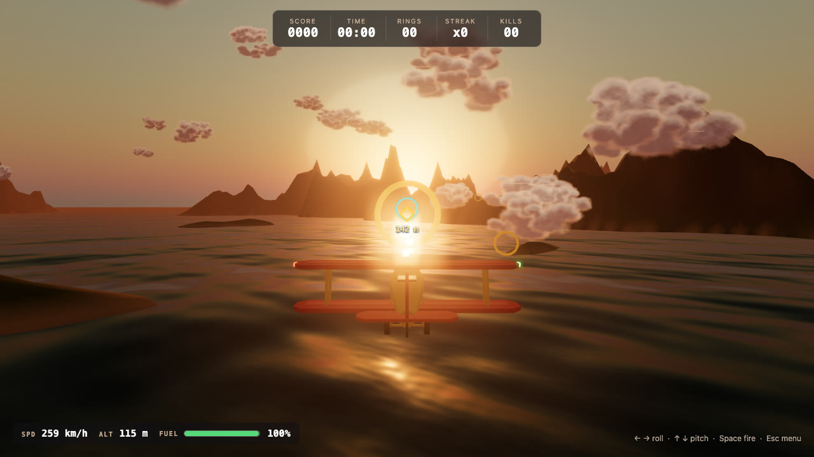
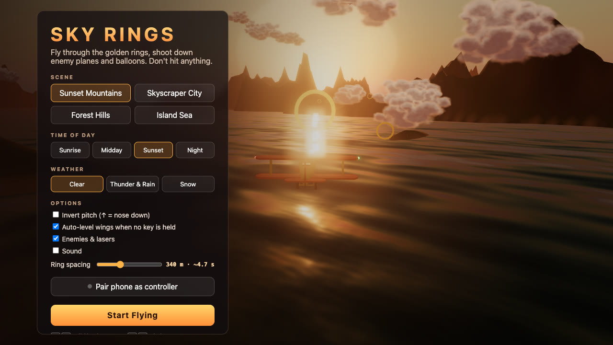
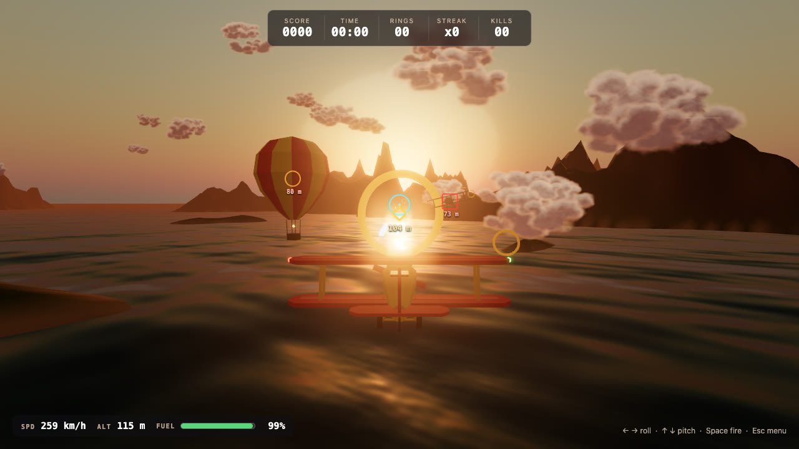
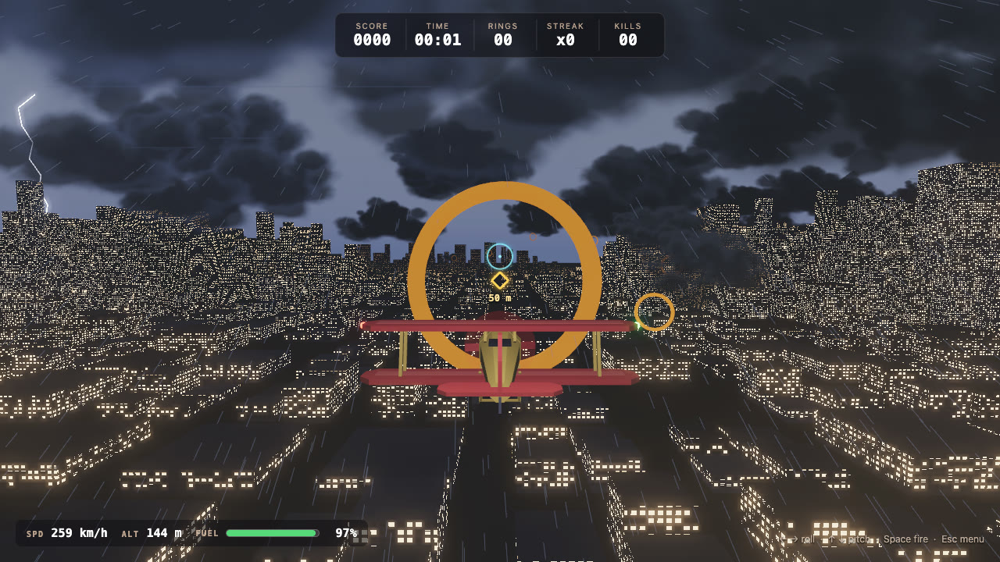
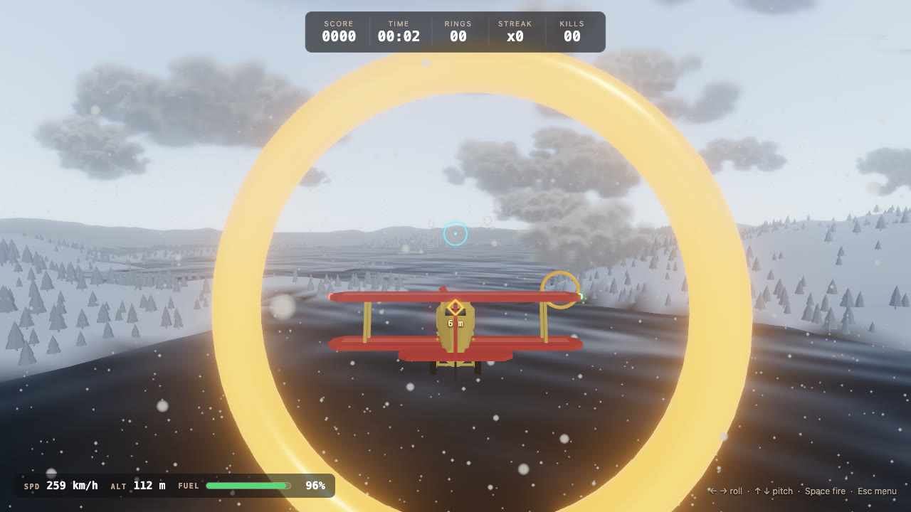
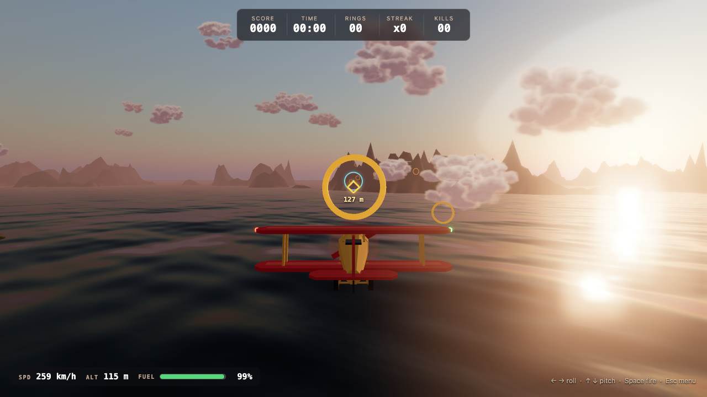
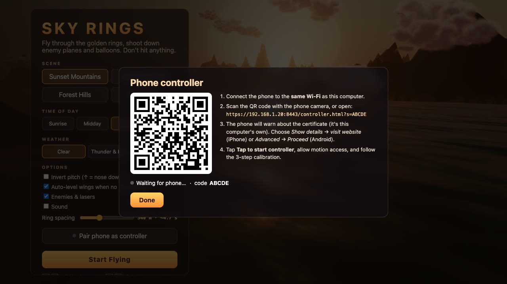
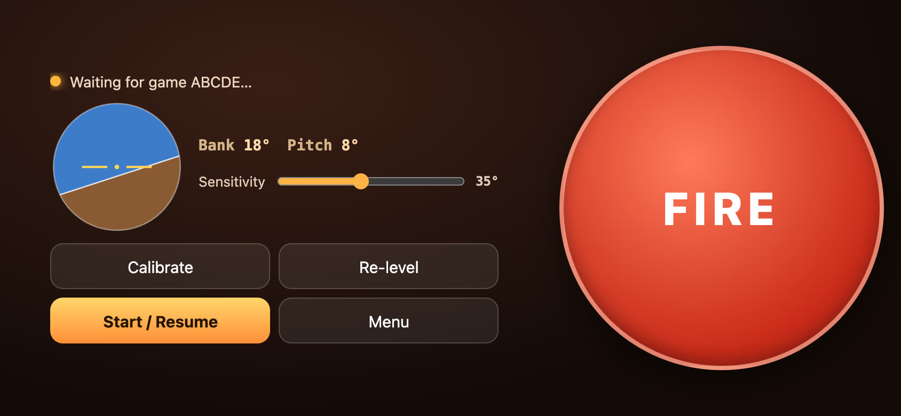
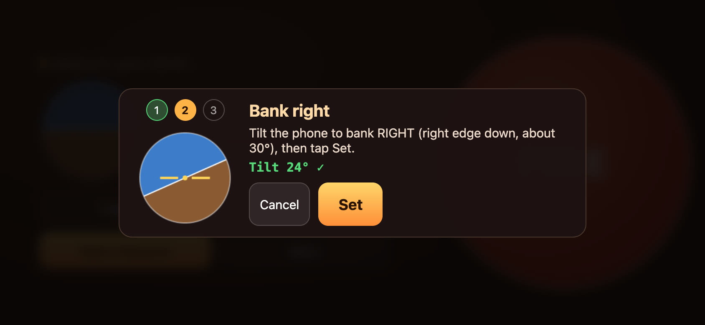

# Sky Rings — a browser flight game

Fly a low-poly biplane through endless winding courses of golden rings, shoot down enemy planes and hot-air balloons, and keep your fuel topped up. You can fly over mountains, a skyscraper city, forests or islands, at four times of day and in three kinds of weather. Fly with the keyboard, or pair your phone and tilt it like a yoke.

Built with [three.js](https://threejs.org/). There's no build step, and the only thing to install is Python 3.



## Features

- **Arcade-realistic flight model.** You bank to turn, climbs cost speed and dives add it, and the flight path lags the nose slightly so turns feel weighty. An optional auto-level assist rolls the wings back to level when you let go.
- **Endless ring courses.** A curvy path of gold rings is generated ahead of you. It follows valleys and always clears the terrain and buildings. The first ring is right in front of you, and the spacing between rings is adjustable.
- **4 scenes:** Sunset Mountains (cliffs around a bay), Skyscraper City (procedural blocks with lit windows), Forest Hills (instanced pine trees and lakes) and Island Sea.
- **4 times of day:** sunrise, midday, sunset and night (stars, moon and glowing city windows).
- **3 kinds of weather:** clear, thunder and rain (lightning bolts, thunder, rain streaks and low storm clouds), and snow (falling flakes and snow-covered ground, trees and roofs).
- **Volumetric-looking clouds** you can fly through. They have lit tops, shadowed bases and a glow on their edges when you look toward the sun.
- **Flowing water** made of layered waves, with a sun or moon glint across it.
- **Combat.** Space fires twin lasers. Enemy biplanes come at you head-on or fly ahead of you down the course, and striped hot-air balloons explode when you hit them.
- **Fuel.** Each ring refuels 10%, and fuel burns 10% for each ring-to-ring flight. When you run dry the engine stops and you glide, so you need to make it to a ring to restart.
- **Phone as a controller.** Scan a QR code, calibrate in 3 steps, then tilt the phone to fly and tap FIRE.
- **Procedural sound**, with no audio files: thunder, rain, lasers and explosions.

## Screenshots

| | |
|---|---|
|  **Menu:** scene, time of day, weather and options |  **Combat:** balloons, enemy planes and lasers |
|  **Night thunderstorm** over the city |  **Snow** over the forest at midday |
|  **Island Sea** at sunrise |  **Pairing a phone** with a QR code |

**Phone controller.** The live tilt dial, sensitivity setting and FIRE button, plus the 3-step calibration wizard:




## Quick start

```bash
python3 server.py
```

Then open **http://localhost:8137** in a desktop browser (Chrome, Edge, Brave, Firefox or Safari) and press **Start Flying**.

- Requires Python 3.8+. The game loads three.js from a CDN, so you need an internet connection.
- `server.py` uses only the Python standard library. On first run it also creates a self-signed certificate (using `openssl`) for the phone controller. See [Phone controller](#phone-controller).
- Any static file server works if you only want the keyboard, for example `python3 -m http.server 8137`. The phone controller needs `server.py`.

## Controls

| Key | Action |
|---|---|
| ← / → (or A / D) | Roll and bank. Banking is how you turn |
| ↑ / ↓ (or W / S) | Pitch: ↑ is nose up (flip it with *Invert pitch* in the menu) |
| Space (hold) | Fire lasers |
| Esc / P | Open the menu and pause |
| Enter | Start or resume from the menu |

## How to play

- **Rings:** fly through the gold rings. The pulsing ring is the next one, and the yellow marker points to it when it's off screen. Each ring is worth 100 points, plus 25 more for every extra ring in your current streak. Missing a ring turns it red and resets your streak.
- **Fuel:** shown bottom left. Each ring adds 10%. Fuel burns 10% in the time it takes to fly from one ring to the next, so if you hit every ring your tank stays level. At 0% the engine stops and you glide down; fly through a ring to restart it.
- **Enemies:** red brackets mark enemy planes, which take 2 hits and are worth 300 points. Orange circles mark balloons, which take 1 hit and are worth 150. Aim with the cyan crosshair.
- **Crashing:** hitting the ground, water, a building, a tree or an enemy resets your score. You respawn just before the next ring with a full tank.

### Menu options

- **Scene / Time of day / Weather:** any combination works. Changing one starts a fresh run.
- **Invert pitch:** makes ↑ point the nose down, like a real flight stick.
- **Auto-level wings:** rolls the wings back to level when no roll key is held.
- **Enemies & lasers:** turn this off for a pure ring run.
- **Sound** and **Ring spacing** (200–600 m, about 3–8 s between rings).

Settings are saved in the browser.

## Phone controller

Tilt the phone to fly: a level phone flies level, and tilting banks and pitches the plane to match (up to 70° of bank and 40° of climb or dive). The big button fires the lasers.

1. Run `python3 server.py`, open the game, and click **Pair phone as controller** in the menu.
2. Connect the phone to the **same Wi-Fi** as the computer and scan the QR code.
3. The phone warns about the certificate, because it's your computer's own self-signed one. Continue anyway: on an iPhone choose *Show Details → visit this website*; on Android choose *Advanced → Proceed*.
4. Tap **Tap to start controller**, allow motion access (iPhone), and follow the calibration:
   1. hold the phone the way you want to fly level, then tap **Set**,
   2. bank right about 30°, then tap **Set**,
   3. tilt the top edge away from you (nose down), then tap **Set**.

Tips:
- **Re-level** resets only the level position. **Sensitivity** sets how far you tilt the phone for full control.
- **Start / Resume** and **Menu** on the phone control the game.
- Pressing a keyboard arrow takes over from the phone while it's held.
- The controller works in landscape and, with rotation lock on, upright too. On Android it switches to fullscreen landscape when started. On iPhone, *Share → Add to Home Screen* opens it fullscreen without browser bars.

**Why HTTPS and a server?** Phone browsers only share motion sensors with secure (HTTPS) pages. `server.py` serves the game on `http://localhost:8137`, which only this computer can reach. It serves the controller over HTTPS on port `8443` on your local network, and passes the phone's tilt and fire messages to the game. Only the game's own files are served. If macOS asks whether Python may accept incoming connections, allow it, or the phone can't connect.

## Project structure

```
index.html            game page: HUD, menu, pairing panel (three.js via import map)
style.css             game UI styles
server.py             local server: game (HTTP), phone controller (HTTPS), message relay
controller.html/.css  phone controller page
controller.webmanifest, icon.svg   "Add to Home Screen" support for the controller
js/
  main.js        boot, game loop, input, menu, scoring, fuel, camera
  flight.js      flight model (FLIGHT_PARAMS holds the tuning numbers)
  aircraft.js    low-poly biplane (player and enemy colours)
  world.js       scene definitions, streaming terrain, water shader, city and forest
  atmosphere.js  time-of-day and weather presets, sky, moon, stars, rain, snow, lightning
  clouds.js      instanced billboard clouds with procedural texture and shading
  course.js      ring path generation and ring pass/miss detection
  combat.js      lasers, enemy planes, balloons, hits
  effects.js     wingtip smoke trails, explosions
  hud.js         HUD: stats, next-ring marker, crosshair, enemy markers, fuel gauge
  sound.js       procedural audio (Web Audio)
  phone.js       game side of the phone controller
  controller.js  phone side: accelerometer, calibration, FIRE button
  noise.js       seeded random numbers, hashing, simplex and fractal noise
docs/screenshots/     images used in this README
```

## Troubleshooting

- **Blank page or "Loading…" forever:** make sure you opened the game from the server (`http://localhost:8137`), not by double-clicking `index.html`, and that you have an internet connection for the three.js CDN.
- **Pairing panel says the server is missing:** you're using a plain static file server. Run `python3 server.py` instead.
- **The phone can't open the link:** check both devices are on the same Wi-Fi, that the firewall allows Python, and that your network doesn't isolate devices from each other (guest networks often do).
- **The phone connects but the plane doesn't move:** finish the calibration on the phone. The status dot turns green when the controller is ready.
- **Your network address changed:** restart `server.py`. It creates a new certificate for the new address automatically.
